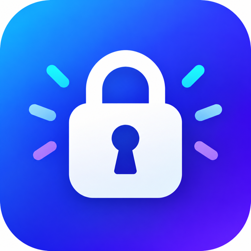

<p align="center">
  
</p>

<p align="center">
  <picture>
    <source media="(prefers-color-scheme: dark)" srcset="https://shieldcn.dev/header/grid.svg?title=Password+Generator&subtitle=Never+use+an+insecure+password+again&logo=keepassxc&mode=dark" />
    
  </picture>
</p>

<p align="center">
  <a href="https://passwordgenerproject.netlify.app"></a>
  <a href="https://github.com/thiernoyunus/password-generator"></a>
  <a href="https://github.com/thiernoyunus/password-generator"></a>
  <a href="https://github.com/thiernoyunus/password-generator/stargazers"></a>
</p>

Click a button and get two random 15-character passwords made from upper and lower case letters, numbers and symbols.

**Live demo:** <https://passwordgenerproject.netlify.app>

## Getting started

Install the dependencies and run the project:

```
npm install
npm start
```

## Built with

HTML, CSS and JavaScript, run with [Vite](https://vitejs.dev/) (see the Vite docs to learn more about configuring it).

## Credit

Built as part of a [Scrimba](https://scrimba.com/courses) course. More from Scrimba: [Frontend Career Path](https://scrimba.com/fullstack-path-c0fullstack) · [Scrimba Pro](https://scrimba.com/pricing)
